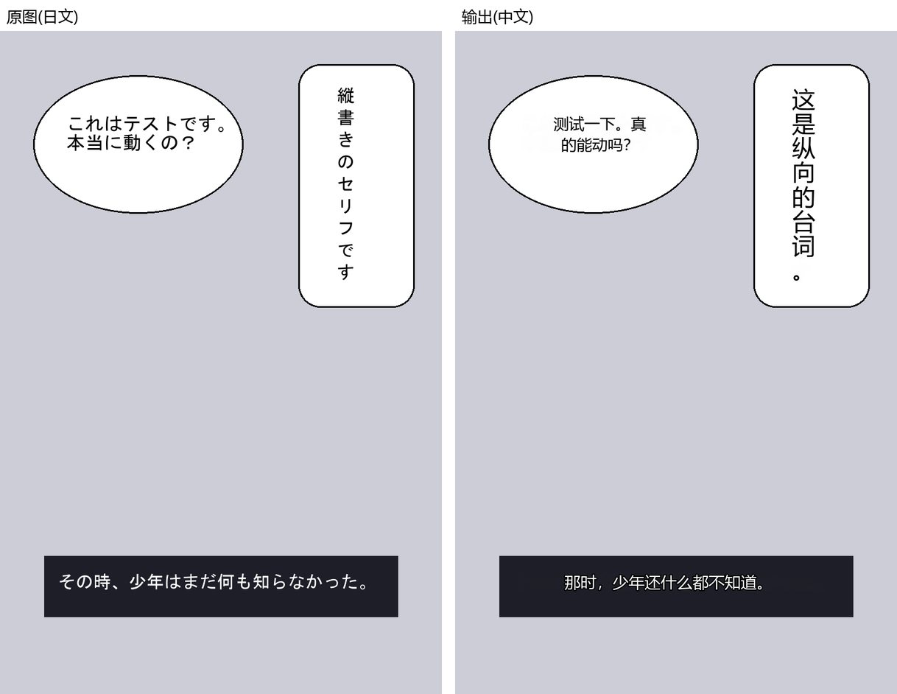

# comic-gen: local manga translation

English | [简体中文](README.md)

Drop in a manga folder / ZIP / CBZ / EPUB / PDF. It runs **text detection → OCR → translation → inpainting → typesetting** and writes back the same format. Everything runs locally on your GPU: no API key, no network after the models are downloaded.



> The image above is an **original synthetic page** (characters and dialogue are original to this repo, drawn by [`scripts/make_demo_page.py`](scripts/make_demo_page.py); crude, and not a real manga page, to avoid copyright issues). It was run with the default setup (Sakura-14B) with no manual retouching: all 7 text regions were detected and translated, about 74 s for the page including model loading (RTX 3060 12 GB). Full-size original and output are in [`docs/demo/`](docs/demo/). **Visible flaws**: a stray 「 opens the translation in panel 3, the "...!" in the vertical bubble of panel 1 is cramped, and "起動シーケンス" came out as a rather literal "启动程序". Try it on a real chapter to judge for yourself.

> **Windows build**: [Releases](https://github.com/yoyoset/comicgen/releases) has `comicgen-<version>-win64-cpu.zip` (about 0.38 GB, CPU runtime only, no models). Unzip, run `comicgen\comicgen-ui.exe`. With an NVIDIA card, open the **组件 (Components)** tab and install the GPU components (about 3.1 GB download, 4.8 GB on disk): official PyTorch cu124 and llama-cpp-python cu124 builds, SHA256-checked, resumable. No separate CUDA install is needed, only a recent NVIDIA driver.
>
> **From source**: what to download, where to put it and how to verify it is in [SETUP_FOR_AI.md](SETUP_FOR_AI.md) (written for your AI coding assistant; the file is in Chinese but the commands, URLs, sizes and sha256 values are exact).

**One-line install:** clone the repo, then give your AI assistant (Claude Code, Codex, ...) `SETUP_FOR_AI.md` with this prompt:

> Follow SETUP_FOR_AI.md to install comic-gen on this machine, download the listed models and check their sha256, then run the three checks in section 3 and report the results.

## Requirements (measured)

- Windows, Python 3.13, git, an NVIDIA GPU with a CUDA 12.4 capable driver.
- Default setup (Sakura-14B iq4xs, 8.2 GB) peaks at about 12.0 GB VRAM on an RTX 3060 12 GB (including about 2 GB of desktop use). The margin is thin. On smaller cards swap the translation engine for a smaller GGUF, or run on CPU (much slower).
- About 18 GB of disk for all models.

## Pipeline

| Stage | Component |
|---|---|
| Text / bubble detection | RT-DETRv2 (`ogkalu/comic-text-and-bubble-detector`, Apache-2.0) |
| OCR | manga-ocr (Japanese), EasyOCR (other languages) |
| Translation | local GGUF via llama.cpp: `sakura` (Sakura-14B Qwen3 v1.5, Japanese to Chinese only) or `llm` (any general instruct GGUF, default Qwen3-14B) |
| Inpainting | LaMa |
| UI | PySide6 |

The `llm` engine accepts any valid GGUF (point to it on the model management page); the `sakura` engine uses Sakura's official prompt format and cannot be swapped for another model.

## Run

```powershell
# CLI, one job
.\.venv\Scripts\python.exe -m comic_gen.app.job_service <input> -o <output> --translator sakura --source-lang ja

# UI
.\.venv\Scripts\python.exe -m comic_gen.ui.app
```

Options: `--translator sakura|llm|mock`, `--source-lang ja|en|zh|other`, `--device cuda|cpu`. A batch queue, per-page review/editing and resume-after-interruption are available in the UI; see the Chinese README for details.

## Licenses

Code is MIT ([LICENSE](LICENSE)). **The default Japanese-to-Chinese model, Sakura-14B, is CC BY-NC-SA 4.0 (non-commercial).** PyMuPDF is AGPL-3.0. Full third-party details: [THIRD_PARTY_NOTICES.md](THIRD_PARTY_NOTICES.md).

## Support

If this saved you time, a small donation toward tokens (compute) is welcome. It goes straight into the next round of inference and testing.

<table><tr><td align="center"><br>Alipay</td><td align="center"><br>WeChat Pay</td><td align="center"><br>PayPal</td></tr></table>
