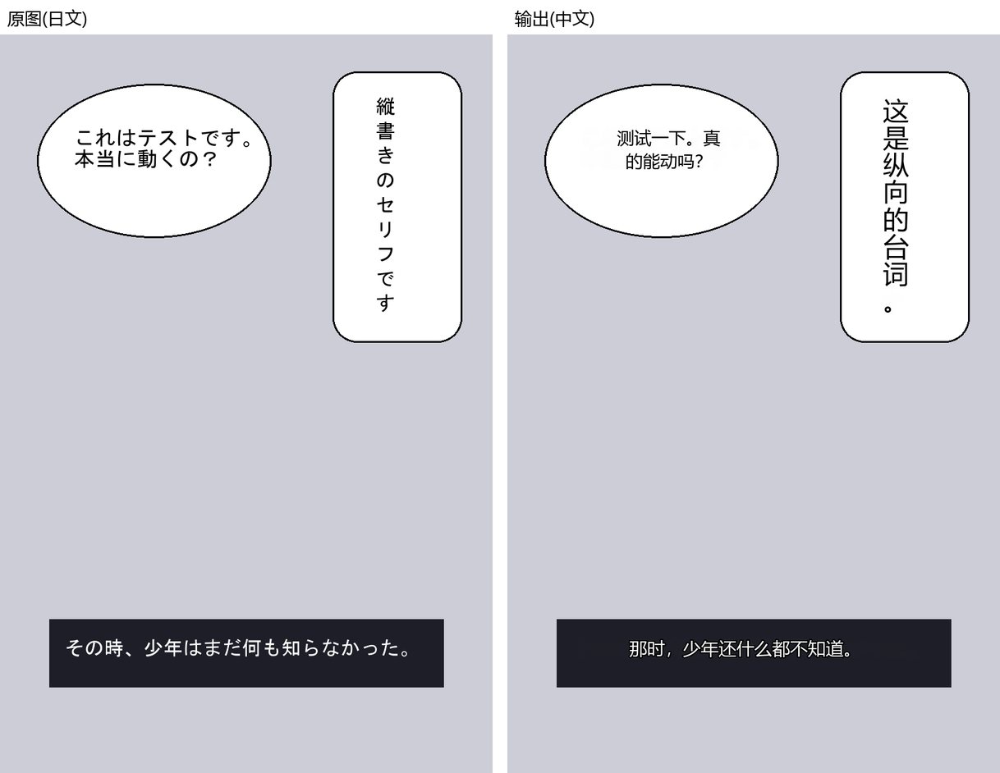

# comic-gen 漫画自动翻译

丢入一个漫画文件夹（或 ZIP / CBZ / EPUB），自动完成：**日文定位 → OCR 识别 → 翻译 → 抹字修复 → 译文贴回**，输出与输入同格式的熟肉。

[English](README.en.md) | 简体中文



> 上图是一张**原创的合成漫画页**（角色与台词均为本仓库原创，由 [`scripts/make_demo_page.py`](scripts/make_demo_page.py) 绘制；画得粗糙，也不是真实漫画，以避免版权问题），
> 用默认配置（Sakura-14B）原样跑出，未做任何手工修图：7 处文字全部检出并译出，整页约 74 秒（含加载模型，RTX 3060 12GB）。原图与译文大图见 [`docs/demo/`](docs/demo/)。
> **能看到的瑕疵**：第三格译文开头多出一个「；第一格竖排气泡里"……！"挤在一起；"起動シーケンス"被译成"启动程序"，偏直译。真实漫画页的效果请自己拿一话试。

> **Windows 安装包**见 [Releases](https://github.com/yoyoset/comicgen/releases)（约 0.38GB，只含 CPU 运行框架，不含模型）。
> 从源码装：要下载什么、放哪、怎么校验，见 [SETUP_FOR_AI.md](SETUP_FOR_AI.md)（写给你的 AI 助手看的清单）。

**源码一句话安装**：克隆本仓库，把下面这句话连同 `SETUP_FOR_AI.md` 一起交给你的 AI 助手（Claude Code / Codex 等）——

> 按 SETUP_FOR_AI.md 把 comic-gen 在这台机器上装好，下载清单里的模型并核对 sha256，最后跑完第 3 节的三项验证再告诉我结果。

## 快速开始

### 方式一：安装包（免装环境）

1. 从 [Releases](https://github.com/yoyoset/comicgen/releases) 下载 `comicgen-<版本>-win64-cpu.zip`（约 0.38GB），
   解压到任意**有空间的**目录（GPU 组件装完后整个目录约 5.6GB），双击 `comicgen\comicgen-ui.exe`。
2. **首次运行会弹出向导**，确认模型存放目录——如果你已经用别的工具（或本机的 subgen 项目）下载过 Sakura/Qwen 之类的
   模型，把目录指向那个位置即可直接复用；弹窗会列出哪些模型已经就位、还差多少。缺的模型去「模型管理」页下载。
3. **有 NVIDIA 显卡**：到「组件」页点「下载并安装 GPU 组件」（约 3.1GB 下载，安装后约 4.8GB），装完点「重启程序以启用」。
   **不用另外装 CUDA**——组件自带 CUDA 12.4 运行库（PyTorch / llama.cpp 官方构建），只需要较新的 NVIDIA 驱动。
   下载有进度、可取消、断网后再点会从断点继续，每个文件都核对 SHA256；官方源连不上会自动换国内镜像。
   没有 N 卡也能用，只是全部走 CPU，本地 14B 翻译模型会非常慢。

排障：`comicgen-ui.exe --self-check` 会把"本次用的是哪份 torch、CUDA 能不能用"写进同目录的 `comicgen.log`。

自己打包：发布用的 CPU 安装包用 `.\.venv-cpu\Scripts\python.exe scripts\build_release.py`（见 [HANDOFF.md](HANDOFF.md)）；
本机自用的整包（带 CUDA，约 5.9GB）用 `.\scripts\build_exe.ps1`——这个脚本只替换 `comicgen-ui.exe` 和 `_internal\`，
不碰 `dist\comicgen\` 下的 `settings.json` / 日志 / 用户模型。

### 方式二：源码运行

```powershell
# 1. 建环境
python -m venv .venv
.\.venv\Scripts\python.exe -m pip install torch torchvision --index-url https://download.pytorch.org/whl/cu124
.\.venv\Scripts\python.exe -m pip install -e .

# 2. 启动 UI
.\.venv\Scripts\python.exe -m comic_gen.ui.app
```

首次运行会自动下载模型（检测 ~170MB、OCR ~450MB、抹字 ~200MB，Sakura 引擎另需 ~8.2GB；大文件下载慢请耐心等待）。

## 翻译引擎

全部本地推理，不联网、不需要 API Key。

| 引擎 | 说明 |
|---|---|
| `sakura`（日文默认） | 本地 Sakura-14B（Qwen3 v1.5）GGUF，专精日译中轻小说/漫画风格，**仅支持日文源** |
| `llm`（非日文默认） | 本地通用 LLM（Qwen3-14B GGUF，非思考模式），支持日/英/中/其它多语言 |
| `mock` | 假翻译，用于离线自测 |

源语言选好后界面会自动推荐对应引擎；两个引擎的具体权重文件都可以在「模型管理」页单独换成
别的本地文件，不必用默认下载的那份。**`llm` 这一档专门支持自由换模型**：不管想换更快的
小模型还是更强的大模型，「定位…」指向任意有效 GGUF 文件即可，不用改代码、不用重新打包
EXE——校验只查文件头确认是 GGUF，不卡任何具体模型的字节数。`sakura` 不支持这样换，它的
提示词模板是照着 Sakura 官方格式写死的，换成别的模型权重结构不兼容会直接跑不起来。

源码运行时，本地翻译引擎的 GPU 版轮子这样装（它用的 CUDA 12.4 运行库借用 GPU 版 torch 自带的那份，不用另装 CUDA Toolkit）：

```powershell
.\.venv\Scripts\python.exe -m pip uninstall llama-cpp-python -y
.\.venv\Scripts\python.exe -m pip install llama-cpp-python --extra-index-url https://abetlen.github.io/llama-cpp-python/whl/cu124
```

## 译后编辑（校对）

跑完的任务会在工作目录里留下 `pages.json`（每页原文/译文/坐标 + 各模型实际路径 + 阶段耗时，还有
`run.log` 完整日志）。**校对在应用内完成**，不需要碰任何文件：

1. 翻译页点「校对本次结果…」直接打开最近一次任务，或在「校对」页点「打开工作目录…」选择任意任务目录。
2. 画布上每个检测框都可点：选中后右侧显示原文，改译文后点「应用译文」（快捷键 **Ctrl+Enter**）保存。
3. 「重渲染本页」只重新生成这一页的图（GPU，较慢），适合快速预览改动效果。
4. 全部改完点「导出全部…」——只有这一步会把校对修改真正写进最终交付物（文件夹/ZIP/PDF），
   单页重渲染不会更新最终包。注意：导出会重新打包到输入旁的默认位置（`<输入名>_translated`），
   即使当初为任务指定过自定义输出路径；完成弹窗会给出实际产物位置。

「需要注意」列表会列出检测置信度低 / OCR 没识别出文字 / 缺译文 / 整页失败的区域，不必通读全书。

## 批量翻译

手上有几十卷漫画（文件夹 / ZIP / EPUB / PDF 混合）想一口气全跑完？切到「批量」页签：

1. 「添加文件…」多选或「添加文件夹…」一次加入多个输入；重复输入会提示「已在队列中」，不会加重复。
2. 核对源语言 / 翻译引擎 / 排版方向（与翻译页一致，对所有队列任务生效），点「开始队列」。
3. 任务**逐个顺序执行**（一块 GPU 同时只能跑一个模型任务），每个任务完成后自动开始下一个，
   全程**不弹任何对话框**——睡一觉回来全部跑完，状态全在列表里（排队/运行/完成/部分完成/失败/取消，
   带颜色区分）。

- 每个任务有独立的工作目录和 `pages.json`，失败 / 取消的任务不阻断队列，其余任务照常执行。
- 选中已完成的任务可以直接「打开输出目录」，或点「校对…」进入该任务的校对页。
- 队列中间被「停止」后再次「开始队列」：已完成的不会重跑，被停止 / 失败的从各自断点继续。
- 「清空已完成」把结束状态的任务从列表里清掉，方便开始下一批。

## 命令行

不需要 UI 也能跑一次任务（安装后可直接用 `comicgen` 命令）：

```powershell
.\.venv\Scripts\python.exe -m comic_gen.app.job_service <输入> -o <输出> --translator sakura
```

参数：`--translator sakura|llm|mock`、`--source-lang ja|en|zh|other`、`--device cuda|cpu`。
输出路径留空按默认规则推导（见下表）。

## 输出规则

| 输入 | 输出 |
|---|---|
| 文件夹（含子目录） | 同目录 `<名>_translated\` |
| ZIP / CBZ | 同目录 `<名>_translated.zip / .cbz` |
| RAR / CBR | 同目录 `<名>_translated.cbz`（RAR 不可写，转 CBZ；解压需系统装 WinRAR/UnRAR） |
| EPUB | 同目录 `<名>_translated.epub`（结构保留，图片原位替换） |
| PDF | 同目录 `<名>_translated.pdf`（每页 @150dpi 渲染为图，输出合并回 PDF；可在 UI 调整） |

## 大图自动降采样

设置页的「全局 DPI」（默认150）不只管 PDF——图片输入（文件夹/ZIP/CBZ/RAR/CBR/EPUB）
里长边超过这个 DPI 对应参考开本（B5，同人志/漫画最常见的实体书开本）像素上限的图会先
等比缩小再进流水线，原图不受影响、只在工作目录里另存一份缩小版。2026-08-22 实测：一本
原图长边 6307px 的同人志，LaMa 抹字这一步耗时随像素数量级增长，约 4.4 分钟/页；缩小到
150dpi 对应的约 1515px 长边后大幅回落到正常速度。不想要这个行为可以把「全局 DPI」调高
（比如 600，B5 下对应约 6060px 长边，基本不会触发），没有单独的开关。

## 模型复用

模型（检测/OCR/翻译/抹字）默认走 HuggingFace 缓存（`HF_HOME`/`HF_HUB_CACHE`），可以和本机其它
项目共用同一份，不必各自下载一遍。首次运行的向导、以及「模型管理」页的「扫描本机已有模型」，
都会自动探测已有缓存并直接复用。每个模型也可以单独指定路径。

## 常见问题

- **任务卡在「加载模型」很久**：首次运行要下载模型（检测 ~170MB、OCR ~450MB、抹字 ~200MB，Sakura 引擎另需 ~8.2GB），大文件下载慢请耐心等待；模型都就位后会自动离线运行，不联网。
- **报「输入路径不存在」**：路径打错了或文件被移走，重新选择正确的输入。
- **报磁盘空间不够**：输出位置可用空间不足以存放译文图和最终产物，清理磁盘或把「输出路径」改到空间更大的位置。
- **报「模型未就绪」**：去「模型管理」页下载或「定位…」缺失的模型；已定位的文件被移走或大小不对时会明确报错，需重新定位。
- **报「引擎不匹配」**：Sakura 只支持日文源，非日文请改用「通用本地 LLM」。
- **任务中断/失败后恢复**：每页结果实时落盘，用相同的输入/输出路径重新运行即可从断点继续，不会重跑已完成页；失败页会回退用原图打包，保证交付物页数完整。
- **中途想腾出显卡做别的事**：翻译页点「暂停」会在当前页结束后释放显存（GPU 完全空闲），之后点「继续」从同一位置接着跑；暂停期间点「停止」则按停止处理，之后可重跑续上。
- **「校对」改完了但最终包没变化**：单页「重渲染本页」只更新工作目录里的图，必须点「导出全部…」才会重新打包最终交付物。
- **控制台中文乱码**：是 Windows 控制台 GBK 显示问题，日志文件本身是 UTF-8，不影响使用。
- **交付物图片比原图分辨率低**：原图长边超过「全局 DPI」对应的参考开本像素上限会被自动
  等比缩小（见「大图自动降采样」一节），原图本身不受影响。想要交付原分辨率就把「全局
  DPI」调高（比如 600）。
- **想换 `llm` 引擎用的模型**：不用改代码、不用重新打包——直接去「模型管理」页对 `llm` 那一行
  「定位…」，选中想用的 GGUF 文件即可，只要文件头是合法 GGUF 就会被接受（2026-08-22 起
  `llm` 的校验不再卡具体某个模型的字节数，见上面「翻译引擎」小节）。
- **改了 `core/manifest.py` 本身（比如换 `sakura` 的默认权重、或改 `llm` 的默认自动下载项），
  EXE 却还在用旧的**：`dist\comicgen\comicgen-ui.exe` 是打包好的产物，改源码不会让已打包的
  EXE 自动变，必须 `.\scripts\build_exe.ps1` 重新打包才生效（该脚本运行中会拒绝执行，先关掉
  正在跑的 comicgen-ui.exe）。`sakura`/`lama` 这类严格校验字节数的 key，如果 `dist\comicgen\
  settings.json` 里的 `model_files` 有旧绑定，重新打包后会报「文件大小异常」，需要手动清掉
  那条绑定（或改「定位…」到新文件）才会回落去按 manifest 里的新文件名重新搜索/下载。

## 许可

本项目代码 MIT，见 [LICENSE](LICENSE)。**默认日译中模型 Sakura-14B 是 CC BY-NC-SA 4.0（非商用）**，
第三方模型与依赖的完整许可（含 PyMuPDF 为 AGPL 的注意事项）见 [THIRD_PARTY_NOTICES.md](THIRD_PARTY_NOTICES.md)。

## 硬件要求（实测）

默认配置（Sakura-14B iq4xs ≈ 8.2GB）在 RTX 3060 12GB 上跑完整流程，显存峰值约 12.0GB（含桌面占用约 2GB），
**余量很小**；同时开着别的吃显存的程序可能显存不足。显存更小的卡请把翻译引擎换成更小的模型（「模型管理」页），
或在设置里选 CPU（慢很多）。

## 技术栈

检测 RT-DETRv2（ogkalu/comic-text-and-bubble-detector，Apache-2.0）· OCR manga-ocr/EasyOCR ·
抹字 LaMa · 翻译本地 Sakura/通用 LLM（均为 GGUF，走 llama.cpp）· 界面 PySide6 / PyInstaller EXE

方案文档见 [docs/PROPOSAL.md](docs/PROPOSAL.md)。

## 赞助

如果这个项目帮你省了时间，欢迎赞助一点 Token（算力）。你的支持会直接变成下一轮的推理与测试成本，让它持续维护。

<table><tr><td align="center"><br>支付宝</td><td align="center"><br>微信支付</td><td align="center"><br>PayPal</td></tr></table>
